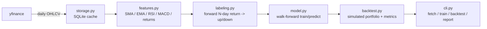

# papertrader

A paper trading engine that uses machine learning to generate buy/flat
signals on US equities, then simulates how a portfolio following those
signals would have performed.

> **Disclaimer:** This is an educational / portfolio project. It simulates
> trades against historical data (paper trading) — it does not place real
> orders and is not investment advice.

## Architecture



## Status

**Milestone 1 (current):** data pipeline only — fetch daily OHLCV via
`yfinance` and cache it in SQLite. Feature engineering, labeling, the ML
model, and the backtest engine are tracked as issues and land in follow-up
milestones.

## Setup

```bash
cd Claude/paper-trading-ml
python3 -m venv .venv
source .venv/bin/activate
pip install -e ".[dev]"
```

## Usage

```bash
python -m papertrader fetch --tickers AAPL MSFT --start 2023-01-01
```

This populates `data/papertrader.sqlite` with daily OHLCV rows for the
given tickers.

## Tests

```bash
pytest -q
```
