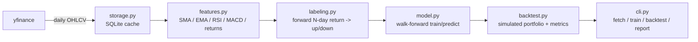

# papertrader

A paper trading engine that uses machine learning to generate buy/flat
signals on US equities, then simulates how a portfolio following those
signals would have performed.

> **Disclaimer:** This is an educational / portfolio project. It simulates
> trades against historical data (paper trading) — it does not place real
> orders and is not investment advice.

## Architecture



## Status

Full pipeline is in place: data fetch, feature engineering, labeling, a
walk-forward-evaluated baseline classifier, a backtest engine, and
RandomForest hyperparameter tuning, wired up end-to-end through the CLI.
A news-sentiment feature is tracked as a stretch-goal issue.

## Setup

```bash
cd Claude/paper-trading-ml
python3 -m venv .venv
source .venv/bin/activate
pip install -e ".[dev]"
```

## Usage

**1. Fetch and cache daily OHLCV bars:**

```bash
python -m papertrader fetch --tickers AAPL --start 2023-01-01
```

This populates `data/papertrader.sqlite` with daily OHLCV rows for the
given tickers.

**2. Walk-forward evaluate the baseline classifier** (per-fold accuracy /
precision / recall, chronological expanding-window splits — no lookahead):

```bash
python -m papertrader train --ticker AAPL --horizon 5 --n-splits 5
```

```
 fold  train_size  test_size  skipped  accuracy  precision  recall
    0         100         80    False     0.538      0.512   0.600
    ...

Mean accuracy: 0.52  Mean precision: 0.51  Mean recall: 0.55
```

**3. Simulate trading** on the stitched walk-forward out-of-sample
predictions (each day's signal only ever uses a model trained on data
strictly before it):

```bash
python -m papertrader backtest --ticker AAPL --commission-bps 5 --output equity.csv
```

Prints the tail of the simulated equity curve and optionally writes the
full curve (`position`, `daily_return`, `equity` per day) to a CSV.

**4. One-shot performance summary:**

```bash
python -m papertrader report --ticker AAPL
```

```
Ticker: AAPL
Period: 2023-01-03 to 2024-12-30
Total return:    xx.xx%
CAGR:            xx.xx%
Sharpe:            x.xx
Max drawdown:    -x.xx%
Win rate:        xx.xx%
Final equity:  xxxxx.xx
```

**5. Compare RandomForest against the baseline**, with a small walk-forward
grid search over `n_estimators`/`max_depth`:

```bash
python -m papertrader tune --ticker AAPL --n-estimators 100 200 --max-depth 0 5 10
```

```
 n_estimators  max_depth  mean_accuracy  mean_precision  mean_recall
           200          5          0.55            0.53         0.58
           ...

LogisticRegression baseline mean accuracy: 0.52
Best RandomForest mean accuracy:            0.55
```

`--max-depth 0` means unlimited depth. Each combination gets a fresh
RandomForest per walk-forward fold — same no-lookahead evaluation `train`
uses, just repeated across the grid.

Shared flags across `train`/`backtest`/`report`/`tune`: `--horizon` (label
lookahead in days, default 5), `--threshold` (forward-return cutoff for an
up label, default 0.0), `--n-splits` (walk-forward fold count, default 5),
`--db-path` (default `data/papertrader.sqlite`). `backtest`/`report` also
take `--position-size`, `--commission-bps`, and `--initial-capital`.

## Tests

```bash
pytest -q
```
